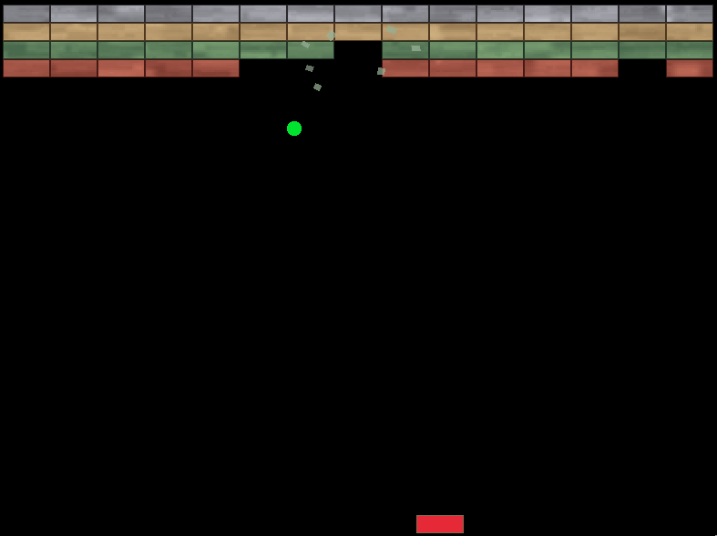
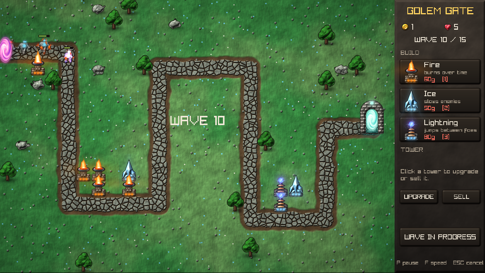
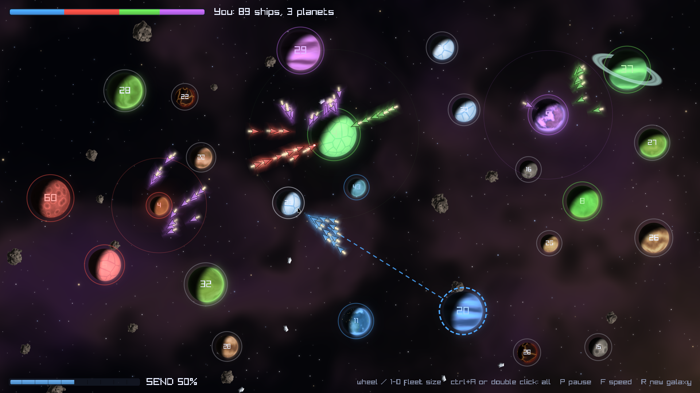

# Zero Sprite Engine

This project aims to make a 2D engine with **purely** procedurally generated content. This means no more sprite sheets and fixed resolution artwork! Every single visible object shall be described as a mathematical formula.

## Tools

- Profiler
    - Measure the RAM, CPU and graphics usage for a specific demo
    - Should be able to show bottle-necks, hot paths, FPS consistency

- Stress test demo (`src/demos/stress`)
    - Adds load in stages: many entities, many different shaders, animation, moving lights, spawning
    - Prints frame times per stage, for comparing engine changes

- Entity editor
    - A tool that lets the user to compose visual effects, characters from the same composable functions that make up the visual entities in the demos
    - The tools lets the user set parameters and see animations if some parameters are variables (between certain set intervals)
    - Give a few presets like fire/terrain/brick that already give a composition of functions describing the entity with tweakable parameters

## First demos to accomplish

- Breakout
    - Increase complexity of brick and ball texture as project evolves, "bricked wall" background
    - Add brick explosions

- A simple tower defense
    - One preexisting level
        - A road from starting to end point
        - Around it terrain
        - Terrain & road textures procedurally generated (and a bit randomized)
        - The color tone also randomly generated between sensible values
    - Shop with 3 different types
        - Fire (burn damage over time)
        - Ice (slows)
        - Lightning (projectiles bounce to closest enemy)
        - Each can be upgraded twice
    - Get gold for each enemy killed
    - Enemies come in waves
    - You can buy towers or upgrade them, however each occupies space, can't stack them
    - Enemies are animated characters which can be constructed from VFX (golems for example)
    - Enemies get progressively stronger
    - Each enemy getting to the end point reduces our lives (let's say 5), but disappear when they get there
    - End point should be some kind of gate
    - Showcase different buildings and projectiles as project evolves

- Space fighting game
    - Galcon Fusion clone
    - The background is space with stars, space debris, asteroids etc
    - Randomly generated map with one or multiple opponents (bots)
    - Each player (or bot) starts with one planet which generated ships that you can send to another planet to capture
    - Planets are also randomly generated
    - Spaceships can be simple but still resemble a triangular spaceship

- "Flappy Bird" clone
    - Sky generation
    - Bird generation
- Large game project
    - TD wars with logistics, "heroes", minions
    - Robotic synthwave style
    - Infinite zooming

## TODO

Engine enhancements proposed so far, roughly in order of value for effort. Each should be checked with the profiler (see `CHANGELOG.md`).

- Shading cost
    - Noise detail by screen size: fade out fbm layers finer than a pixel, so small or zoomed-out looks get cheaper and stop shimmering
    - A `cached()` node that renders only the still part of a look into a texture (e.g. a brick's surface, while its hit flash and cracks stay live)
    - A cheaper `lit` option using screen-space derivatives (one height evaluation instead of four)
    - Render expensive layers such as backgrounds at reduced resolution
- Draw calls
    - Instancing: draw consecutive entities sharing a shader in one call, with per-entity data in a texture buffer and a custom vertex shader
- Particles
    - CPU-simulated particles (velocity, drag, gravity, lifetime, collisions) drawn with instancing
    - GPU particle simulation with transform feedback, colliding with any look's distance field
- Lighting
    - Tower defense: fire towers and lightning orbs as scene lights on the golems
    - Deferred 2D lighting: color, height and glow buffers lit in one pass, for many lights, glowing objects lighting their neighbours, and soft shadows
- Text as visual effects
    - A vector stroke font as a distance field, so text gets outlines, glow, embossing and animation like any other look
- Tooling
    - Hot-reload `.look` files into running demos
    - A tree view of a look in the editor, with the profiler's cost per node
- Platform
    - Move to a modern graphics API only once a feature needs compute shaders
