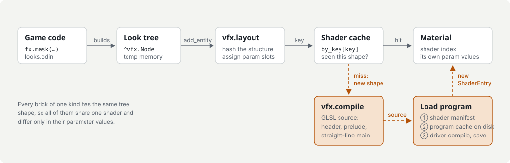
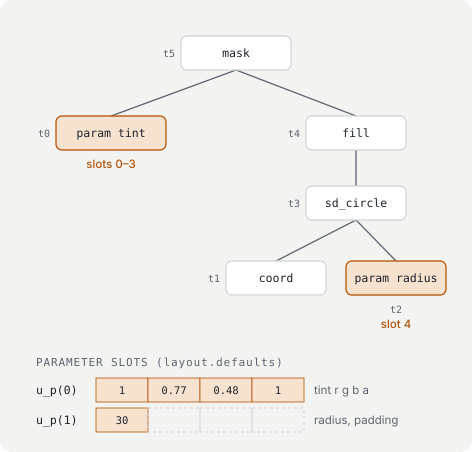
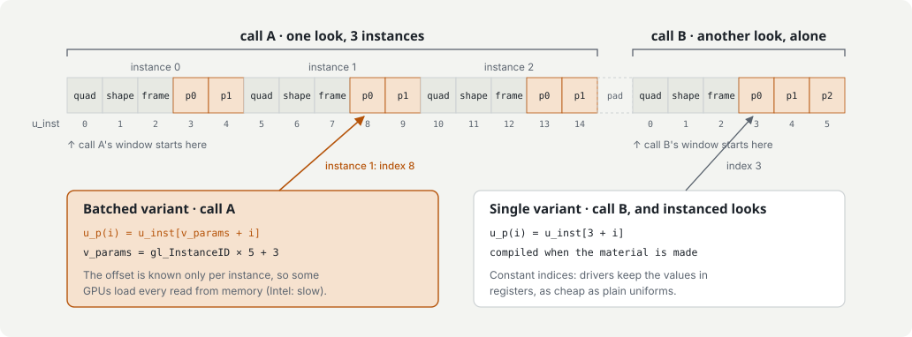

# Architecture

Zero Sprite Engine draws everything except text with fragment shaders that it generates from trees of math. A game never loads an image: it describes each visible thing as a function of position (and time, and a few numbers it changes while playing), and the engine turns that description into GLSL, compiles it once, and draws every entity that uses it.

This document follows that path from game code to the GPU. The diagrams are SVG files in [`diagrams/`](diagrams/), so they can be edited alongside the code.

## The packages

| Package | Role |
|---|---|
| `src/engine/vfx` | The look language: node constructors (`node.odin`), the look-script parser (`script.odin`), code generation (`codegen.odin`) and the GLSL library (`glsl/`). It knows nothing about entities or windows. |
| `src/engine` | The runtime: window and frame loop (`engine.odin`), entities and layers (`entity.odin`), materials and the shader cache (`material.odin`), batching (`batching.odin`), OpenGL work (`gpu.odin`, with `gpu_posix.odin` and `gpu_windows.odin`), scene lights, the shader manifest and the profiler. |
| `src/demos/*` | Games. Each is a `package main` with its colors, its looks (compositions of `fx.*` calls) and its game logic. |
| `src/tools/editor` | Entity editor: look scripts with a live preview and parameter sliders. |

The engine keeps one global scene: `add_entity`, `set_param`, `run` and the rest act on it.

## 1. Making a look



A look is an expression tree of `^vfx.Node`, built by constructors such as `coord`, `param`, `fbm`, `sd_box`, `fill`, `glow`, `lit` and `stack`. Every node is a pure function of the local position `p` (object space, origin at the entity's center, y down). Constructors take plain numbers, vectors and colors as well as nodes, and record the procedure that called them, which the profiler uses to name looks. Trees live in temporary memory and are freed at the end of the frame.

`add_entity(look, pos, size, options)` makes a `Material` for the entity:

1. `vfx.layout` walks the tree once. It hashes the tree's structure into a key and gives every number in it a parameter slot. The slots' starting values are the material's own copy of its parameters.
2. The shader cache is looked up by that key. Entities with the same tree shape, such as all bricks of one kind, share one shader and differ only in their parameter values.
3. A key seen for the first time is compiled: `vfx.compile` generates the GLSL, and the program is taken from the first of
   - the **shader manifest** (`.shader-cache/<game>.shaders`): every shader the game used in its last runs, compiled at startup before the first frame;
   - the **program cache** (`~/.cache/zero_sprite_engine/shaders`): linked programs saved with `glGetProgramBinary`, keyed by the sources, the GPU and the driver, shared by all games;
   - the **driver**, which compiles it; the program is then saved to the program cache.

`precompile(look)` does the same at load time, for looks that first appear mid-game. Games change a material's numbers with `set_param(id, name, value)`; that never recompiles anything.

## 2. From tree to shader



This is the `main` that `vfx.compile` generates for the tree above, unedited:

```glsl
// the instance's record, unpacked
u_size = v_shape.xy; u_rot = v_shape.z; u_age = v_shape.w;
u_extent = v_frame.xy; u_origin = v_frame.zw;
vec2 p = (fragTexCoord - 0.5) * u_extent;
// one local per node, children first
vec4 t0 = vec4(u_p(0).x, u_p(0).y, u_p(0).z, u_p(0).w);
vec2 t1 = p;
float t2 = u_p(1).x;
float t3 = length(t1) - t2;
float t4 = fill_aa(t3);
vec4 t5 = t0 * vec4(1.0, 1.0, 1.0, t4);
finalColor = t5;
```

- Every node is computed once, into a local. Only subtrees evaluated at other positions (`at`, `lit`, `lit_scene`, `shatter`) become GLSL functions `n<id>(vec2 p)` that can be called more than once.
- Every number is a parameter slot, packed four to a `vec4` and read with `u_p(i)`. Only the structure of the tree is compiled into the shader. With `InitOptions.bake_constants` (AlgoGame, Light Room), plain constants are written as literals instead: faster shaders, but looks differing in a constant no longer share one.
- `walk` in `codegen.odin` hashes the tree and assigns the slots in one pass, which both `layout` and `compile` use, so the key and the generated code always agree. Anything that changes the generated code must also go into that hash.
- `gate(condition, value)` computes `value` only inside an `if`, so an expensive subtree costs nothing where it isn't needed.
- The generated code calls helpers from `glsl/prelude.glsl` by name (noise, distance functions, lighting, particles) and reads its inputs as declared in `glsl/header.glsl`.

Some looks need more than a few numbers:

- `param_array` puts a list of values (a few hundred at most) in the parameter slots, read by index with `pget`.
- `data_array` keeps larger lists in a float texture owned by the material, read with `dget`; only the rows the game changed are uploaded.
- `instances` makes an instanced look: one entity drawing one quad per record of an array, in a single draw call, through `vertex_instanced.glsl`. AlgoGame's rock slices, corals and light splats work this way.
- `bins` (from `bin_shapes`) sort long shape lists into a grid, so each pixel only visits the shapes in its cell.
- 3D looks (Light Room) cast a ray through each pixel: sphere-traced solids, point lights, capsule shadows and occlusion, haze.

## 3. One frame


`run(on_update)` repeats until the window closes or the game calls `quit()`:

1. **Update.** Scene time advances (scaled by `set_time_scale`; `ZSE_FIXED_DT` makes it a fixed step), and the game's `on_update` moves entities and sets parameters.
2. **Offscreen.** Cached looks whose texture is stale are re-rendered, and layer images are drawn: buffer layers that other looks read with `layer_sample`, and reduced-resolution layers (drawn small, optionally blurred, and stretched over the screen).
3. **Batching** (`batching.odin`). Walking the layers in z order, each entity joins the newest group of its shader and blend mode, unless an entity in a later group overlaps its quad. A 32 × 32 grid over the screen finds the overlaps. Only the order of overlapping quads is kept, so even mixed layers share draw calls. Sorted layers (by y, or by a sort key such as distance from a 3D camera) are ordered first.
4. **The draw list.** The groups become a `DrawList`: instance records, and steps that are either draw calls or raylib draws (text and cached looks). Consecutive instances with the same shader, blend mode, pixel size and data texture share one call.
5. **Submit.** All records are uploaded into a uniform buffer at once. Then each call binds a 64 KB window of it starting at its first record, picks its program (section 4), sets the few real uniforms (matrices, time, pixel size, scene lights once per frame) and textures, and issues `glDrawArraysInstanced`.

A bloom layer or a reduced-resolution layer interrupts the list: what was batched so far is drawn first, then its image. After the list, the frame is presented. Vsync starts on and, in `Auto` mode, turns off if it keeps the game below its target frame rate.

On the GPU, `vertex.glsl` draws one quad per instance from the first three `vec4`s of its record. The look's fragment shader then runs per pixel and reads the instance's parameters from the same buffer.

## 4. Instance records and the two shader variants



Each instance is a record of `vec4`s:

| Row | Contents |
|---|---|
| 0 | quad center and size on screen |
| 1 | logical size, rotation, age |
| 2 | drawn extent (size plus padding), world origin |
| 3 … | the look's parameter slots |

A call's records start where the driver allows a uniform buffer window to start (`GL_UNIFORM_BUFFER_OFFSET_ALIGNMENT`), hence the padding between calls.

How a shader finds its parameters depends on how many instances the call draws, so each look shader has two variants:

- **Single** (`u_p(i) = u_inst[3 + i]`): for calls of one instance, and for instanced looks. The indices are constants, so drivers keep the values in registers, as cheap as plain uniforms. It is compiled when the material is made.
- **Batched** (`u_p(i) = u_inst[v_params + i]`, with `v_params = gl_InstanceID × stride + 3`): for calls of several instances. The offset is known only per instance, which some drivers turn into a memory load per read: on Intel this made Light Room's letters take 75% longer. It is compiled the first time a look is drawn several to a call (or by `precompile`), and the shader manifest records it for later runs.

`call_program` in `material.odin` picks the variant for each call; `vfx.batched_source` makes the batched source from the single one.

## Around the draw path

- **Scene lights** (`lights.odin`): up to 8 point or directional lights and an ambient color, read by looks built with `lit_scene`.
- **Blending:** `Alpha`, `Additive`, `Premultiplied` (one look can draw a solid shape and the light around it) and `Max`.
- **Collisions** (`collision.odin`): rectangle and circle colliders, centered on their entity.
- **Profiler** (`profiler.odin`): CPU zones as a call tree, GPU time per look from timestamp queries, shader compile times, memory. F3 toggles its overlay; `ZSE_PROFILE_SECONDS` runs a benchmark and writes a report.
- **Monitors:** `fill_monitor` makes the window borderless over a chosen monitor, which raylib can't do on Wayland.
- **Platforms:** Linux binds a few rlgl symbols and loads OpenGL through the system GLFW that raylib uses (`gpu_posix.odin`); on Windows raylib bundles GLFW, so OpenGL is loaded through WGL (`gpu_windows.odin`).

## Where each step lives

| Step | Code | What to look for |
|---|---|---|
| Building looks | `vfx/node.odin`, `vfx/script.odin` | One constructor per node; look scripts map onto them through `BUILTINS` |
| Key and slots | `vfx/codegen.odin` | `walk` hashes the tree and assigns slots; `emit_local` writes the straight-line `main` |
| Shader cache | `material.odin` | `try_make_material`, `load_look_shader`, `call_program` |
| Reusing programs | `shader_manifest.odin`, `gpu.odin` | Startup compiles from the manifest; the `glGetProgramBinary` cache on disk |
| Batching | `batching.odin`, `entity.odin` | Groups by shader and blend with a 32 × 32 overlap grid; special layers in `render_entities` |
| Drawing | `material.odin`, `gpu.odin` | `add_instance` builds records and calls; `submit_draws`, `draw_instances` |
| GLSL library | `vfx/glsl/` | `header.glsl` (`u_p`), `vertex.glsl`, `vertex_instanced.glsl`, `prelude.glsl` |

## Keeping this document current

Update this file and its diagrams in the same commit as any change to what they describe: a new step in the frame, a change to how looks are cached or compiled, a new kind of record or uniform, renamed procedures or files. The diagrams are hand-written SVG; edit them as text, keep their light and dark color rules in step, and check them by opening the file or rendering it (`rsvg-convert`).
